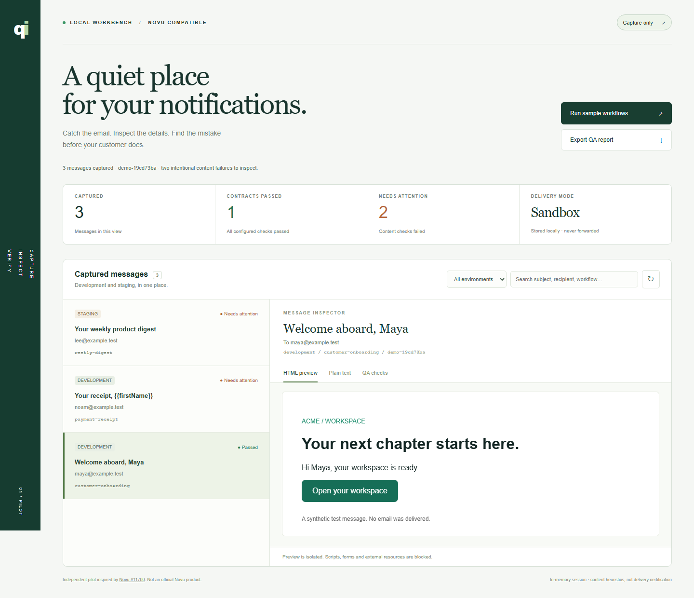

# QA Inbox for Novu

An independent, working pilot inspired by [Novu issue #11766: Built-in Email Sandbox Provider](https://github.com/novuhq/novu/issues/11766). Capture rendered emails locally, inspect HTML and text, and turn common content mistakes into repeatable QA checks.

**Not an official Novu product, native provider contribution, or hosted email service.** This repository is a standalone prototype by [Lior Mashiach](https://github.com/liorma6).



## Try it

Requires Node.js 22 or later. The application has **zero runtime package dependencies**.

```sh
git clone https://github.com/liorma6/novu-qa-inbox.git
cd novu-qa-inbox
npm start
```

Open **http://127.0.0.1:8787**, then select **Run sample workflows**. Three synthetic emails travel through signed local HTTP into the real capture endpoint:

| Workflow | Environment | Expected QA result |
|---|---|---|
| Customer onboarding | development | Pass |
| Payment receipt | development | Fail: unresolved `{{firstName}}` |
| Weekly digest | staging | Fail: missing text fallback and marketing unsubscribe link |

The intentional content failures demonstrate the tool; the automated tests assert those outcomes and should pass. No real recipients receive these messages. The receiver has no mail delivery/forwarding implementation.

Filter messages, inspect the isolated HTML preview, switch to plain text or QA checks, and download a JSON report. Reports include recipients, subject and checks, but omit the raw HTML/text bodies.

## What is implemented

- `X-Novu-Signature` HMAC-SHA256 verification over the exact request bytes, using UTF-8 secret keys.
- Separate development/staging capture endpoints and signing keys.
- In-memory inbox, subject/recipient/workflow/run search, environment filtering.
- Exact-retry deduplication by environment and delivery `id`; conflicting content returns 409.
- Content checks: unresolved `{{variable}}` / `${variable}`, nonblank subject, plain-text fallback, and a simple unsubscribe-link check when explicitly marked as marketing.
- HTML preview with an opaque sandbox and a restrictive CSP: scripts, forms and external resources are disabled.
- Bounded 256 KiB request size and 500-message capacity, with explicit rejection instead of silent eviction.
- JSON evidence export, backend tests, a real published Novu provider integration test, and desktop/mobile Playwright tests.

## Connection contract

The receiver uses the JSON and HMAC contract implemented by Novu's **Email Webhook** provider. Supply distinct secrets through `QA_DEV_SECRET` and `QA_STAGE_SECRET` (at least 16 characters each). Without them the application generates temporary keys and the built-in demo works automatically. Restarting clears the keys and captured data.

Send a JSON `POST` to `/capture/development` or `/capture/staging`. Include `Content-Type: application/json` and `X-Novu-Signature: <hex HMAC-SHA256 of raw body>`.

```json
{
  "id": "test-run-1-welcome",
  "to": ["maya@example.test"],
  "from": "app@example.test",
  "subject": "Welcome, Maya",
  "html": "<h1>Welcome, Maya</h1>",
  "text": "Welcome, Maya",
  "headers": {
    "x-qa-workflow": "customer-onboarding",
    "x-qa-run": "test-run-1",
    "x-qa-category": "transactional"
  }
}
```

`id` is optional. When present, an identical raw-body retry returns the original capture ID; a changed raw body with the same delivery ID returns 409. Without `id`, every request creates a new capture. The `x-qa-*` headers are optional pilot metadata carried inside the email options; they are not built-in Novu workflow fields. CC/BCC, attachments and arbitrary headers are not retained in this pilot.

### Exactly what the Novu test proves

`tests/provider.test.js` calls **`EmailWebhookProvider.sendMessage` from the published `@novu/providers@2.6.6` package**, using its real serialization, signature and HTTP client. The receiver accepts the rendered message, deduplicates a second delivery, and rejects a different environment key. The provider is loaded from its module path to avoid initializing unrelated integrations.

This is **provider-to-inbox integration**, not an end-to-end run of Novu Cloud or the self-hosted API/worker stack. The package is pinned and is not claimed to equal the current `next` source. Current Novu source includes outbound destination protection that may block local/private targets. Keep those protections enabled; a product integration needs an approved development endpoint or a reviewed native capture adapter. This pilot does not modify that policy.

## Run the checks

```sh
npm ci
npx playwright install chromium
npm run check
```

Or run `npm test`, `npm run test:provider`, and `npm run test:e2e` separately. Browser tests start their own server on port 8788 and exercise desktop Chromium and a mobile viewport. The integration package and Playwright are **development dependencies only**; `npm start` needs neither. The published provider package brings a large dependency graph with upstream audit findings. Do not deploy that test dependency graph as the runtime of this prototype.

See [VALIDATION.md](VALIDATION.md) for observed results and [PILOT.md](PILOT.md) for the proposed next step. CI runs the same three suites on Linux and uploads the browser report/screenshots.

## Boundaries

- Local, single-user workbench bound to `127.0.0.1`. Read APIs have no user authentication; anyone with access to the local machine can inspect its captured data. Do not expose it publicly or use it for customer data.
- In-memory, bounded storage; no durable retention, multi-tenancy, timestamp-based signature expiry, production replay protection or audit history.
- Content rules are transparent heuristics, not proof of template correctness, deliverability, email-client rendering or legal compliance. The unsubscribe check only recognizes an HTTP(S) href containing `unsubscribe`; it does not validate the destination.
- No SMTP server, actual delivery, forwarding, release/replay to real recipients, attachment handling, or live Novu dashboard integration.
- The frontend does not auto-poll. Use Refresh after an external capture. Demo requests refresh automatically.

## Why this pilot

Issue #11766 asks for safe capture, inspection and a dedicated UI. Its discussion already has contributors interested in a native provider, so this prototype deliberately explores the **inspection and QA surface** without claiming their work or submitting a competing native-provider PR. Existing products such as Mailtrap already cover email sandboxes; the hypothesis here is the value of a Novu-oriented workflow QA experience, not a claim to have invented email capture.

MIT licensed. Feedback and integration scope are welcome.
